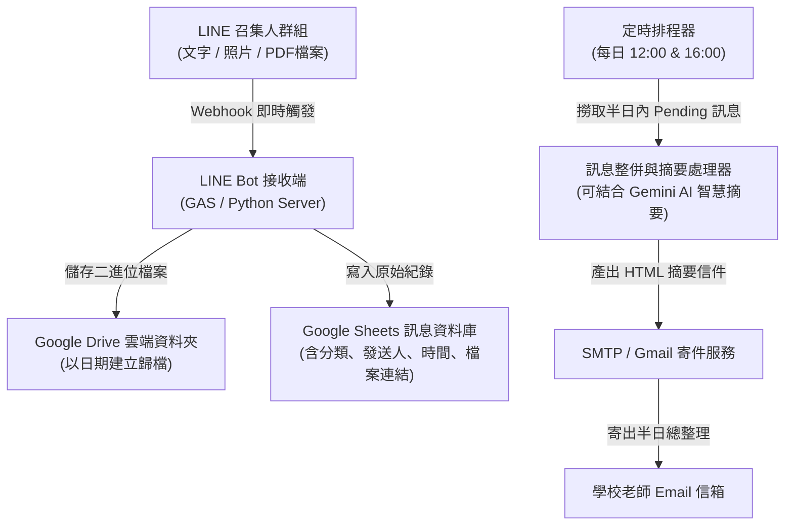

# 🏫 學校召集人群組 LINE Bot 訊息彙整與定時郵件通知系統

本專案旨在透過 LINE Bot 監聽「召集人群組」（如竹林召集人群組）的日常訊息，將重要行政公告、教務通知、活動調課、榮譽榜、照片及 PDF 檔案自動歸檔至 **Google 試算表（Google Sheets）** 與 **Google 雲端硬碟（Google Drive）**，並在每日 **12:00** 與 **16:00** 自動產出結構化的「半日訊息彙整」，透過 Email 定時發送給全體或指定科目的學校老師。

---

## 📂 專案資料夾結構

```text
linebot-school-notifier/
├── README.md                     # 專案總覽與快速指引
├── docs/
│   ├── message_schema.md         # 訊息分類、資料結構與 Google Sheets 欄位定義
│   └── system_architecture.md    # 系統架構、技術選型評估與處理流程
└── templates/
    └── email_digest_preview.html # 每日 12:00/16:00 發送給老師的 HTML 郵件範本預覽
```

---

## 🎯 核心運作流程



---

## 📌 關鍵需求與設計重點

1. **圖文檔案立即持久化**：
   - LINE 伺服器上的圖片與 PDF 附件有短期保存限制，因此機器人收到當下必須立即下載轉存至 Google Drive。
2. **訊息連續性整併**：
   - 截圖中常見老師先發說明文字，隨即補發圖片或 PDF，系統應支援時間視窗（如 1~2 分鐘內）關聯整併，避免郵件資訊零碎分散。
3. **分群分類過濾**：
   - 區分：📢 行政/人事公告、📝 段考/教務通知、🏃 訓育/活動異動、🏆 榮譽榜、⚠️ 緊急更正。
