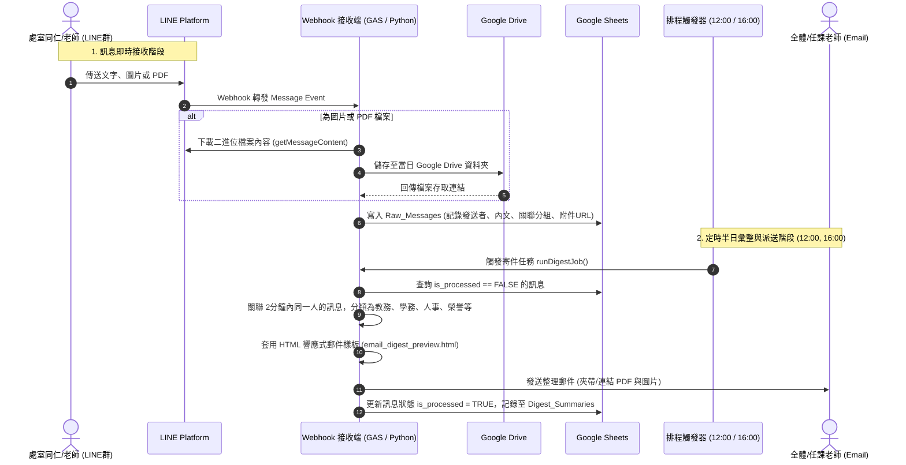

# 🏗️ 系統架構設計與實作方案評估

本文件說明 LINE Bot 訊息攔截、暫存儲存、排程整併、與 Email 發布的技術架構與建置路徑。

---

## 一、 兩種可行架構方案比較

針對學校常見的 IT 維護環境與資源成本，提供以下兩種主流建置方案供討論選定：

### 方案 A：Google Apps Script (GAS) 純雲端無伺服器方案（🌟 推薦：最適合學校）
- **運作模式**：
  - 以 Google Apps Script (GAS) 發布為 Web App，作為 LINE Messaging API 的 Webhook URL。
  - 直接內建調用 Google Sheets、Google Drive 與 `GmailApp`。
  - 使用 GAS 內建的「觸發條件（Triggers）」設定每日 12:00 與 16:00 執行彙整與寄件函式。
- **優點**：
  1. **零主機成本**：免租用雲端 VM 或伺服器（完全免費）。
  2. **原生存取 Google 生態系**：試算表、雲端硬碟、Gmail 都在同一個帳號內，不需複雜的 GCP Service Account 與 OAuth 憑證交換。
  3. **維護負擔極低**：學校資訊老師或承辦人員只需打開瀏覽器即可修改邏輯或調整樣式。
- **限制**：
  - 單次執行時限為 6 分鐘（彙整半日訊息並發送幾十封信綽綽有餘）。
  - 若群組瞬間大量圖片發送，需注意 GAS 同步下載的頻寬，但學校群組通常發訊頻率不高，影響極小。

---

### 方案 B：Python (FastAPI / Flask) + Google APIs 獨立伺服器方案
- **運作模式**：
  - 本地電腦或雲端容器（如 Google Cloud Run / Render / VPS）運行 Python 伺服器。
  - 透過 LINE Python SDK 監聽事件，透過 Google Service Account 寫入 Google Sheets API & Google Drive API。
  - 使用 APScheduler 或系統 CronTab 定時在 12:00 與 16:00 執行。
- **優點**：
  1. **進階 AI 處理能力強**：可直接呼叫 Gemini 1.5/2.0 API 或本機 OCR（Tesseract），自動讀取圖片中的文字（如未刷卡名單表格、圖卡內容）並自動摘要。
  2. **彈性自由度高**：不受 Google Apps Script 執行環境與資源配額限制。
- **限制**：
  - 需要常態運行的伺服器與公網網址（如 HTTPS 憑證、ngrok 或固定 IP / 雲端託管費用）。
  - 維護門檻較高，需要程式部署環境。

---

## 二、 訊息處理與排程發布生命週期

---

## 三、 建議之安全與隱私防護

1. **群組過濾機制**：
   - 僅限定本機器人所在的特定「召集人群組」（透過 `groupId` 驗證），忽略來自其他私聊或未授權群組的訊息。
2. **敏感資訊防護**：
   - 截圖中如「全校上下班未刷卡紀錄」涉及同仁個人隱私名冊，建議提供標籤或關鍵字判斷，若判定為人事機敏資料，可選擇僅提示「人事室已公告刷卡明細，請參閱公佈欄」，避免直接將人事名單群發給所有人，或者只寄送給行政主管。
